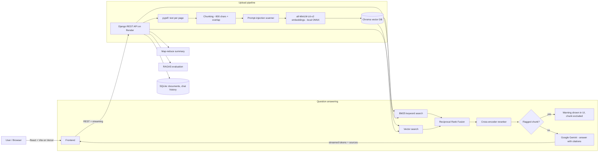

# KnowledgePilot AI

**A secure, evidence-grounded document research assistant.** Upload PDF/TXT files, ask questions, and get answers generated **only from your documents**. Every answer shows the **file name, page number and exact source text**, so you can check it yourself.

> KnowledgePilot uses Retrieval-Augmented Generation (RAG) to **reduce hallucination**. It is not 100% accurate. Every answer can be checked against its sources.

**Live demo:** _frontend URL_ · **API:** _backend URL_ (free Render server: the first request after a while can take ~1 minute while it wakes up)

---

## Features

| # | Feature | How it works |
|---|---------|--------------|
| 1 | Upload page | React drag-and-drop upload. PDF/TXT only, max 10 files, 20 MB each. |
| 2 | RAG core | `pypdf` extracts text page by page (page numbers are kept), then the text is split into ~900-character overlapping chunks, embedded with **all-MiniLM-L6-v2** (local) and stored in **Chroma**. |
| 3 | Answers with citations | Gemini answers only from the numbered sources and cites them like `[1]`. Click a citation to see the file, page and source text. If the answer is missing it replies **"Answer not found in the documents."** |
| 4 | Chat history + streaming | Chats are saved (SQLite) and answers stream token by token (NDJSON stream). |
| 5 | Hybrid search + reranker | **BM25** (keywords) + **vector search** (meaning), merged with Reciprocal Rank Fusion, then reranked by a **cross-encoder** (ms-marco-MiniLM-L-6-v2). |
| 6 | Whole-document summary | **Map-reduce**: summarise each section (map), then combine the partial summaries (reduce). |
| 7 | Evaluation dashboard | **RAGAS** on a test set you write by hand. Reports **faithfulness, answer relevancy, context precision and context recall separately**. They are never combined into one accuracy score. |
| 8 | Prompt-injection detection | Each chunk is scanned at upload time for instructions aimed at the AI (e.g. "ignore previous instructions"). Flagged chunks are **kept out of the LLM prompt** and a warning is shown in the UI. |
| 9 | Deployment | Frontend on **Vercel**, backend on **Render** (free tier). |

## Architecture



## Tech stack (free tier only)

- **Backend:** Django 6 + Django REST Framework, django-cors-headers, gunicorn
- **Frontend:** React (Vite), plain `fetch`, no UI library
- **LLM:** Google Gemini API (free tier, `gemini-flash-lite-latest` by default)
- **Embeddings:** `sentence-transformers/all-MiniLM-L6-v2`, run locally through **fastembed (ONNX)**. Same model, but without PyTorch, so it fits in Render's 512 MB free plan.
- **Reranker:** `ms-marco-MiniLM-L-6-v2` cross-encoder (ONNX)
- **Vector DB:** Chroma · **Keyword search:** rank-bm25 · **PDF parsing:** pypdf
- **Evaluation:** RAGAS (Gemini as judge, local embeddings)

## Project structure

```
knowledgepilot/
├── backend/
│   ├── config/              # Django settings & urls
│   ├── api/
│   │   ├── views.py         # REST endpoints
│   │   ├── models.py        # Document, ChatSession, ChatMessage
│   │   ├── default_testset.json
│   │   └── rag/
│   │       ├── extraction.py   # PDF/TXT -> text per page
│   │       ├── chunking.py     # page text -> chunks (keeps page number)
│   │       ├── injection.py    # prompt-injection detector
│   │       ├── models.py       # local embedding + reranker models
│   │       ├── store.py        # Chroma vector store
│   │       ├── retrieval.py    # BM25 + vector + RRF + reranker
│   │       ├── llm.py          # Gemini client
│   │       ├── qa.py           # prompt, citations, "not found" logic
│   │       ├── summary.py      # map-reduce summary
│   │       └── evaluation.py   # RAGAS evaluation
│   ├── requirements.txt
│   └── build.sh             # Render build script
├── frontend/
│   └── src/
│       ├── api.js           # all backend calls (incl. streaming reader)
│       ├── App.jsx          # tabs
│       └── components/      # DocumentsPage, ChatPage, SummaryPage, EvaluationPage
├── sample_docs/             # example files (one contains a prompt injection on purpose)
└── render.yaml              # Render blueprint
```

## API

| Method | Endpoint | Purpose |
|--------|----------|---------|
| GET | `/api/health/` | Health check |
| POST | `/api/upload/` | Upload files (form field `files`) and index them |
| GET | `/api/files/` | List documents (pages, chunks, flagged chunks) |
| DELETE | `/api/files/<id>/` | Delete a document and its vectors |
| GET | `/api/files/<id>/flagged/` | Flagged (suspicious) chunks |
| POST | `/api/files/<id>/summary/` | Map-reduce summary |
| POST | `/api/chat/` | Ask a question. Streams NDJSON events: `session`, `warnings`, `token`, `sources`, `done` |
| GET | `/api/sessions/`, `/api/sessions/<id>/` | Chat history |
| GET/PUT | `/api/eval/testset/` | Read / save the manual test set |
| POST | `/api/eval/run/` · GET `/api/eval/status/` | Run RAGAS / get results |

## Run locally

Use **Python 3.12** (some dependencies, e.g. onnxruntime and chromadb, may not have Python 3.14 wheels yet) and Node 20+.

**Backend (Windows PowerShell)**
```powershell
cd backend
py -3.12 -m venv venv
.\venv\Scripts\Activate.ps1
pip install -r requirements.txt
copy .env.example .env      # then put your GEMINI_API_KEY in .env
python manage.py migrate
python manage.py runserver
```

**Frontend**
```powershell
cd frontend
copy .env.example .env
npm install
npm run dev
```
Open http://localhost:5173.

> `.env` files are listed in `.gitignore`. Never commit API keys. In the frontend, every `VITE_` variable is visible in the browser, so put only the backend URL there.

## How it works (for the viva)

1. **Why RAG?** An LLM alone can make things up. RAG first **retrieves** the relevant chunks from your documents and then asks the LLM to answer **only from them**. This reduces hallucination and makes every answer verifiable.
2. **Why chunks with page numbers?** The LLM can only read a limited amount of text, and small chunks make search more precise. Every chunk stores its file name and page number so they can be shown as the citation.
3. **Why hybrid search?** Vector search understands meaning ("car" ≈ "vehicle") but can miss exact terms, IDs and names. BM25 is good at exact keywords. Using both and fusing them with RRF gives better recall.
4. **Why a reranker?** A cross-encoder reads the question and the chunk *together*, so it scores relevance more accurately than embeddings alone. It is slower, which is why it only re-scores the top 20 candidates. If even the best chunk scores very low, the system answers "Answer not found in the documents." without calling the LLM.
5. **Prompt injection.** A document might contain text like "ignore previous instructions...". Such chunks are detected with patterns at upload time, excluded from the prompt, and shown as a warning. The system prompt also tells Gemini to treat sources as data, never as instructions (defence in depth).
6. **Map-reduce summary.** A long document does not fit in one prompt. Each section is summarised separately (map), then the partial summaries are combined (reduce).
7. **RAGAS metrics:** *Faithfulness* checks whether the answer is supported by the context. *Answer relevancy* checks whether it answers the question. *Context precision* checks whether the relevant chunks are ranked first. *Context recall* checks whether the retrieved context covers the expected answer. They are reported separately because each one measures a different part of the pipeline (generation vs retrieval).

## Limitations

- Scanned (image-only) PDFs are not supported (no OCR).
- On Render's free plan the disk is temporary: uploaded files, chat history and the index are cleared when the server restarts or sleeps. Re-upload documents before a demo.
- Gemini free tier has rate limits. RAGAS evaluation makes many LLM calls, so keep the test set small (5-10 questions).
- No user login: all uploaded documents are shared by everyone using the deployment.
